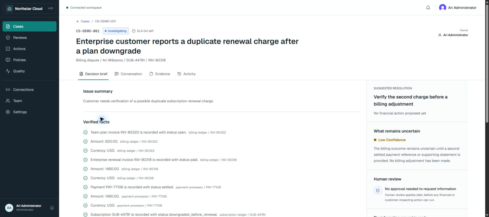
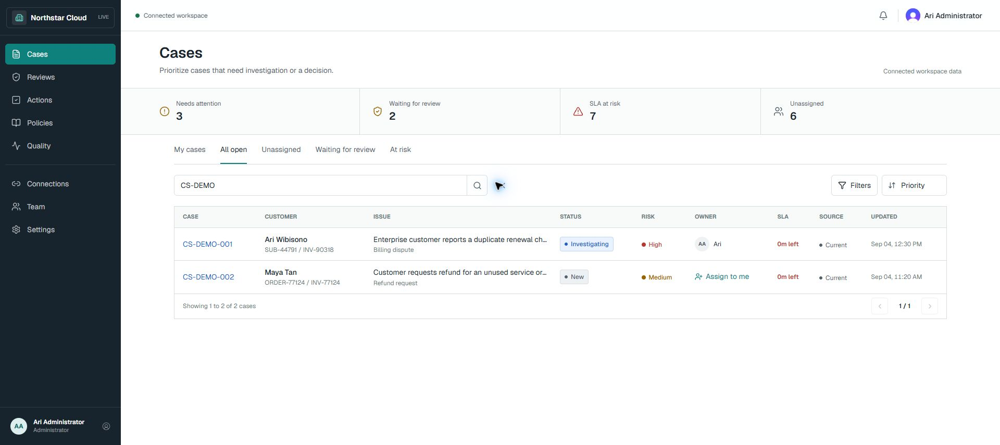
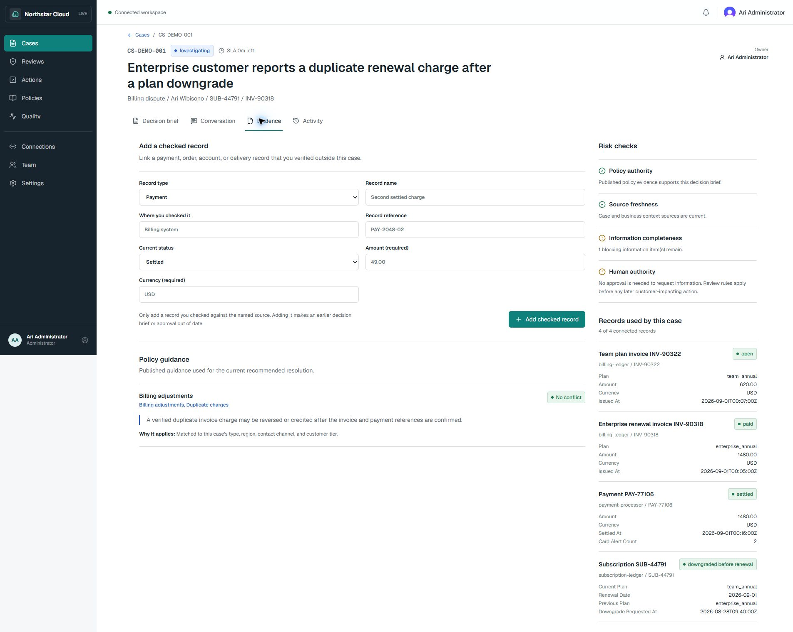
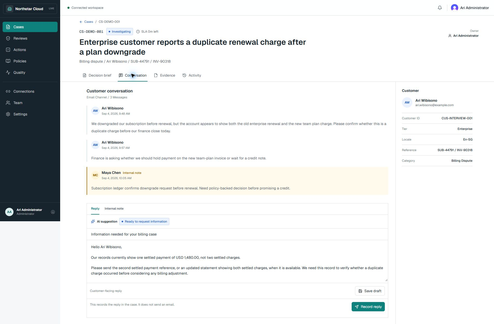
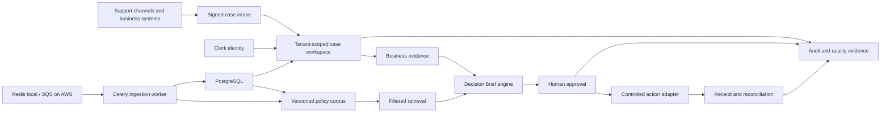

# Case Resolution Copilot

A policy-governed decision workspace for complex customer cases.

Case Resolution Copilot helps a support team assemble scattered evidence, retrieve the applicable
policy version, prepare a reviewable resolution, obtain human approval, and execute a controlled
action with an auditable recovery path. The AI provider may draft bounded narrative from a
server-generated control record;
application controls and authorized people decide what may happen.

> From scattered evidence to an approved, verifiable resolution.

[](docs/evidence/live-product-tour/2026-10-12/README.md)

[Hosted application](https://ai-support-escalation-copilot.vercel.app) | [Engineering case study](docs/portfolio/CASE_STUDY.md) | [Application pack](docs/portfolio/APPLICATION_PACK.md)

The hosted application is invite-only. The public walkthrough contains labelled demo data only.

## Evidence Snapshot

| Result | Measured scope | Evidence |
| --- | --- | --- |
| **40/40** | Policy-correct decisions and correct completion on sealed held-out synthetic cases | [V2 evaluation results](docs/evidence/case-resolution-v2/RESULTS.md) |
| **19/19 actions; 21/21 escalations** | Verified synthetic target actions and required routed/acknowledged escalations | [V2 evaluation results](docs/evidence/case-resolution-v2/RESULTS.md) |
| **18/18** | Exposed decision replay across three SOP rule families and three dated versions per family | [SOP replay summary](docs/evidence/case-resolution-v2/results/sop-replay.json) |
| **83.7%** | Lower raw median decision-workflow time in the earlier developer benchmark: 95 s versus 582 s | [Workflow benchmark](docs/evidence/developer-workflow-benchmark/REPORT.md) |
| **10 passed; 0 HIGH/CRITICAL** | PostgreSQL release tests and findings across three validated demo images | [Release evidence](docs/evidence/case-resolution-v2/PHASE6_RELEASE.md) |

V2 evaluation uses PostgreSQL-backed product APIs, deterministic decision rules and synthetic action
targets. Labels were authored and reviewed by the implementation agent. These results measure the
controlled test scenarios, not general model accuracy or customer production outcomes.

The earlier timing benchmark used one operator and three matched synthetic cases per condition;
complete outcomes were 3/3 with Copilot and 0/3 manually. Its timing is separate from the V2
40-case evaluation and does not measure speedup between equally successful resolutions.

For the evidence trail, see the [V2 release overview](docs/evidence/case-resolution-v2/README.md).

## Latest Engineering Updates

The V2 source extends the governed workflow with:

- **Verified resolution lifecycle:** target read-back checks the approved operation, parameters,
  amount, and effect count before closure; reopening and acknowledged escalation retain their
  own audit events. See the [lifecycle contract](docs/evidence/case-resolution-v2/LIFECYCLE.md).
- **Dated SOP rules:** refund windows, ownership requirements, and escalation thresholds affect
  decisions; policy changes invalidate stale approvals, and rollback preserves action history.
  See [SOP revision evidence](docs/evidence/case-resolution-v2/SOP_REVISIONS.md).
- **Broader controlled operations:** invoice corrections, recovery-email changes, and session
  revocation use explicit authorized parameters and a deterministic synthetic target. The
  [V2 evaluation protocol](docs/evidence/case-resolution-v2/PHASE4_EVALUATION.md) covers the
  decision, review, action, verification, and resolution APIs.

- **Reproducible release package:** isolated Docker startup, migration/seed, restart, backup/restore,
  and ten PostgreSQL integration tests passed; all three image scans had zero HIGH/CRITICAL findings.
  See the [Phase 6 release evidence](docs/evidence/case-resolution-v2/PHASE6_RELEASE.md).

These updates describe the V2 source. The hosted tour documents
the earlier deployment; the decision-workflow timing benchmark above retains its original scope.

## Why It Exists

Complex cases rarely live in one message. Facts can be split across conversations, payments,
orders, account records, policies, and internal notes. A fast AI answer can sound certain while
using stale policy, overlooking missing evidence, or proposing an action nobody authorized.

This product is organized around a more useful set of questions:

> What is known, what is missing, which policy applies, what could go wrong, and who must approve
> the next step?

## Product Workflow

```text
Case intake -> Evidence and applicable SOP -> Decision Brief -> Human approval
            -> Controlled action -> Target read-back -> Verified closure
            -> Safe escalation -> Recipient acknowledgement
```

- **Cases** prioritizes work by risk, SLA, status, ownership, and source freshness.
- **Decision Brief** separates verified facts, missing information, uncertainty, and recommendation.
- **Conversation and Evidence** keep business records and policy citations inspectable.
- **Reviews** bind human authority to one immutable proposal and evidence snapshot.
- **Actions** use idempotency, durable receipts, unknown-outcome handling, and reconciliation.
- **Policies and Quality** govern what the system may rely on and how behavior is evaluated.

Wave 1 adds portfolio-focused backend depth without changing the product boundary:

- Celery uses Redis locally and SQS in the AWS profile to deliver inbox-sync and policy-index jobs,
  while PostgreSQL retains durable status, leases, retry limits, duplicate protection, and
  reprocessing authority.
- A credential-free governed RAG V2 evaluator checks expected sources, retrieval status, latency,
  and sanitized failure events across representative synthetic cases.
- A [live-validated reproducible AWS architecture](docs/architecture/AWS_READY_DEPLOYMENT.md) maps the API,
  worker, and migration processes to ECS/Fargate, RDS PostgreSQL with pgvector, SQS, Lambda, S3,
  Secrets Manager, CloudWatch, least-privilege IAM, and an AWS-side auto-destroy watchdog. An [executable CDK validation
  environment](infra/aws/README.md) now represents that topology with cost-aware, teardown-safe defaults.
  A bounded [AWS live validation](docs/evidence/aws-live-validation/README.md) passed the connected
  ingestion, migration, pgvector, health, queue, and teardown checks. The always-on demo remains on
  Vercel with Neon; AWS is validated deployment architecture, not permanent production hosting.

**Portfolio claim:** Built and live-validated a reproducible AWS deployment architecture using
ECS/Fargate, RDS PostgreSQL with pgvector, S3, Lambda, SQS, CloudFront, IAM, Secrets Manager, and
CloudWatch, with infrastructure designed for safe teardown and redeployment.

Wave 2A adds a practical [orchestrator framework boundary](docs/architecture/ORCHESTRATOR_FRAMEWORKS.md):

- LangGraph is the production/default checkpoint orchestrator around the governed decision engine.
- LangChain Core supplies prompt templates and schema-format instructions on the optional OpenAI
  narrative path.
- CrewAI and AutoGen are isolated, opt-in comparison prototypes with shared input/output safety
  contracts; neither is part of the hosted production path.
- One bounded synthetic-case [live validation](docs/evidence/framework-validation.md) passed the
  shared schema, fact, evidence, approval, and no-false-execution checks on all three paths.

## Product Tour

<table>
  <tr>
    <td width="50%">
      <a href="docs/evidence/live-product-tour/2026-10-12/01-cases-queue.jpg"></a><br>
      <strong>Operational queue</strong><br>
      Triage by risk, SLA, ownership, status, and source freshness.
    </td>
    <td width="50%">
      <a href="docs/evidence/live-product-tour/2026-10-12/02-decision-brief.jpg"></a><br>
      <strong>Decision Brief</strong><br>
      Verified facts, missing evidence, uncertainty, and the review boundary.
    </td>
  </tr>
  <tr>
    <td width="50%">
      <a href="docs/evidence/live-product-tour/2026-10-12/03-evidence.jpg"></a><br>
      <strong>Traceable evidence</strong><br>
      Policy clauses and business records remain connected to sources.
    </td>
    <td width="50%">
      <a href="docs/evidence/live-product-tour/2026-10-12/04-conversation.jpg"></a><br>
      <strong>Conversation</strong><br>
      Customer messages, internal notes, and an evidence-aware response draft.
    </td>
  </tr>
</table>

These [live product-tour screenshots](docs/evidence/live-product-tour/2026-10-12/README.md) were
captured on October 12, 2026, from the hosted demo using synthetic cases. They show the UI, not
end-to-end correctness. The [earlier hosted acceptance record](docs/evidence/hosted-e2e-acceptance/2026-08-05/README.md)
separately covers approved controlled execution and its receipt.

## Authority Model

| Layer | Responsibility |
| --- | --- |
| AI provider | Draft structured narrative from bounded case and policy context. |
| Application controls | Enforce tenant scope, policy freshness, evidence binding, permissions, approval state, and action safety. |
| Human reviewer | Accept responsibility for the exact proposal version before a consequential action. |
| External system | Return a receipt or an explicitly unknown outcome that must be reconciled. |

AI confidence cannot grant approval, bypass missing evidence, or authorize a side effect.

## Architecture



The stack is Next.js, TypeScript, FastAPI, PostgreSQL/pgvector, Clerk, LangGraph, LangChain Core,
and an optional OpenAI narrative provider. It is a modular monolith, not a microservice system.
Deterministic providers keep repository verification independent of paid credentials.

## Verification Evidence

### V2 source and release verification

| Evidence layer | Result |
| --- | --- |
| Source checks | 12/12 passed; Ruff, Mypy over 525 Python files, TypeScript, ESLint, migration, secret, transport, acceptance and traceability checks |
| Source regressions | 699 backend and 186 frontend tests passed |
| Sealed product evaluation | 40/40 policy-correct and correct-completion outcomes on synthetic holdout cases |
| Disposable PostgreSQL release journeys | 10 passed, including migration preservation and unknown-outcome safety after application recreation |
| Isolated demo release | Startup/restart, seeded logical restore, known-good image/config replacement, and scans of three images passed |

The [evidence index](docs/evidence/case-resolution-v2/README.md) records dates, exact tested revisions,
CI links and scope. The hosted tour shows the earlier deployment; the V2 package is validated in
isolated CI and has not been promoted to the hosted demo. The earlier
[V1 regression and provider canary](docs/evidence/case-resolution-evaluation-v1/README.md) remain
separate supporting evidence.

### Baseline coverage artifacts

- The [local acceptance matrix](backend/evaluations/acceptance/local_release_matrix.json) records
  54 controls exercised through 71 acceptance variants.
- The [workflow traceability map](backend/evaluations/workflow/traceability.json) records 19
  traceable proofs across 8 scenarios and 21 workflow variants.

These committed baseline artifacts describe designed coverage; they are not presented as a fresh
full-release or PostgreSQL rerun for the reconstructed revision.

### Historical hosted product evidence

The [hosted deterministic acceptance](docs/evidence/hosted-e2e-acceptance/2026-08-05/README.md)
records Specialist submission, Supervisor approval, one controlled action, durable receipt
capture, duplicate blocking, and Auditor read-only inspection for synthetic case `CS-2050`. It
comes from the predecessor hosted deployment and does not prove that the current reconstructed
commit is deployed.

The [GitHub quality gate](https://github.com/williamlo90/case-resolution-copilot/actions/workflows/quality-gate.yml)
runs on pull requests or manual dispatch, never on every push. It adds dependency audits and a
production Next.js build. This policy avoids accidental GitHub Actions usage while preserving a
review gate.

## Run Without Paid Credentials

Requirements: Python 3.12, `uv`, Node.js, and `pnpm`.

```powershell
git clone https://github.com/williamlo90/case-resolution-copilot.git
cd case-resolution-copilot

cd backend
uv sync --frozen --group dev
uv run python -m scripts.run_release_verification
```

The verifier runs serially and starts no browser, application server, container, database, or
external model call. See the [backend guide](backend/README.md), [frontend guide](frontend/README.md),
and [resource policy](RESOURCE_SAFETY_POLICY.md).

For a synthetic full-stack demo on a separate container host, use the
[Phase 6 demo release guide](docs/runbooks/PHASE6_DEMO_RELEASE.md). Its Compose package builds the
frontend for production serving, migrates and seeds a disposable database, and checks API and UI
readiness. The [validated candidate run](https://github.com/williamlo90/case-resolution-copilot/actions/runs/38901537078)
passed the bounded demo smoke, recovery, database, and image-scan checks. The existing hosted demo
continues to use Vercel, Neon, and Clerk; Docker does not require a new always-on host.

## Claim Boundaries

- This is a production-oriented portfolio project and controlled-pilot candidate, not a claim of
  general production readiness.
- The hosted identity setup uses an invite-only Clerk development instance.
- No client-owned case source or controlled-action sandbox is connected.
- Public benchmark records and synthetic controls test the evaluation system; they are not complete
  client cases and do not prove customer impact.
- Current external gates include real-provider verification and failure drills, application restore
  cutover, production telemetry, accessibility research, penetration testing, bounded load testing,
  and complete anonymized client-case validation.

## Documentation

- [Documentation index](docs/README.md)
- [Product contract](docs/product/PRODUCT_CONTRACT.md)
- [UX architecture](docs/product/UX_ARCHITECTURE.md)
- [Engineering case study](docs/portfolio/CASE_STUDY.md)
- [CV, LinkedIn, Upwork, and interview application pack](docs/portfolio/APPLICATION_PACK.md)
- [API conventions](docs/api/CONVENTIONS.md)
- [Evaluation strategy](docs/backend/EVALUATION_STRATEGY.md)
- [V2 release and evidence index](docs/evidence/case-resolution-v2/README.md)
- [Case Resolution Evaluation V1](docs/evidence/case-resolution-evaluation-v1/README.md)
- [Wave 1 governed RAG evaluation](backend/evaluations/wave1_rag/README.md)
- [AWS-ready deployment architecture](docs/architecture/AWS_READY_DEPLOYMENT.md)
- [Orchestrator framework boundary](docs/architecture/ORCHESTRATOR_FRAMEWORKS.md)
- [Bounded live framework validation](docs/evidence/framework-validation.md)
- [AWS deployment operations runbook](docs/runbooks/AWS_DEPLOYMENT_OPERATIONS.md)
- [Controlled pilot runbook](docs/pilot/PILOT_RUNBOOK.md)
- [Security hardening](docs/runbooks/SECURITY_HARDENING.md)
- [Post-environment verification](docs/runbooks/POST_ENV_VERIFICATION.md)

## Source Use

Copyright (c) 2026 williamlo90. All rights reserved. This public repository is available for
portfolio review; no license to reuse, modify, or redistribute the original source code is granted.
Third-party dependencies retain their own licenses.
